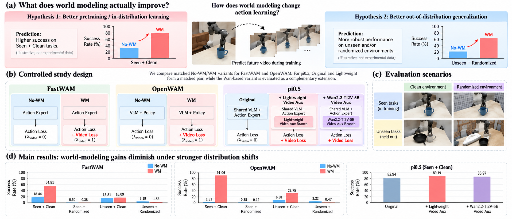
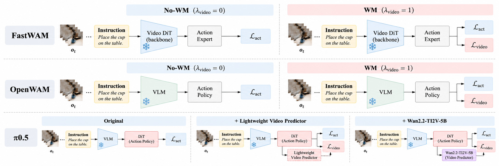

# What Does World Modeling Actually Improve in Robot Action Learning?

> **Code coming soon.** This repository will host the official implementation and evaluation suite.

We conduct a controlled study of world-model supervision in robot action learning across dedicated world-action models and a conventional vision-language-action policy. Our experiments separate gains near the training distribution from robustness under task and environment shifts.

## Key Findings

- World-model supervision substantially improves **Seen + Clean** performance: **+24.38 pp** for FastWAM and **+72.91 pp** for OpenWAM.
- The benefit can arise from improved within-mode execution as well as changed behavior-mode allocation.
- Gains diminish under distribution shift and do not consistently survive environment randomization.
- The same supervision improves the conventional pi0.5 policy by **+6.25 pp** with a lightweight predictor.

## Experiments

1. **Seen-task learning:** ten tasks in clean environments.
2. **Behavior modes:** mode allocation and within-mode success.
3. **Distribution shift:** Seen/Unseen tasks crossed with Clean/Randomized environments.
4. **VLA extension:** predictive supervision for pi0.5.

## Release Status

The paper, training code, evaluation scripts, configurations, and release instructions are being prepared. This README is a public placeholder for the official project repository.

| Resource | Status |
| --- | --- |
| Paper | Coming soon |
| Project page | Coming soon |
| Training code | Coming soon |
| Evaluation code | Coming soon |
| Model weights | To be announced |

## Citation

Citation information will be added when the paper is available on arXiv.

## License

The license will be announced with the code release. Until then, all rights are reserved.
